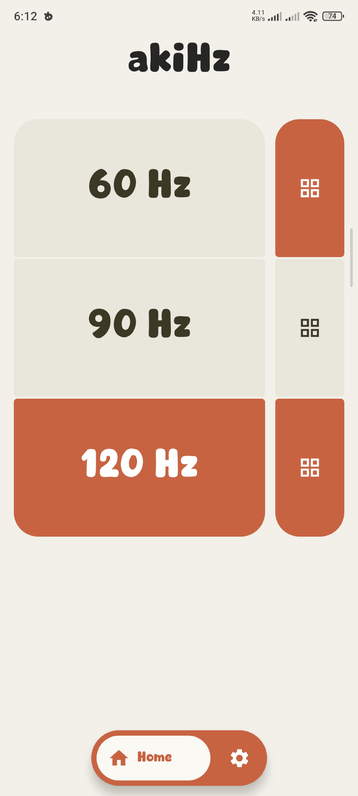
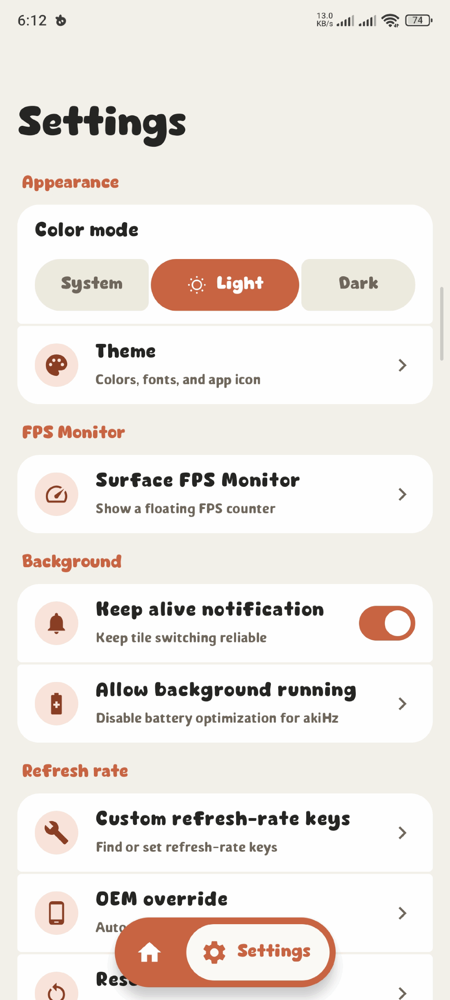
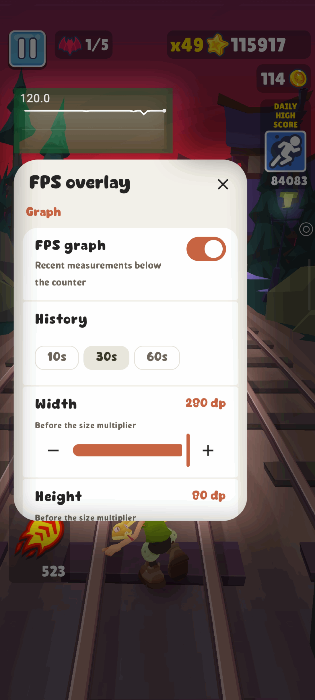
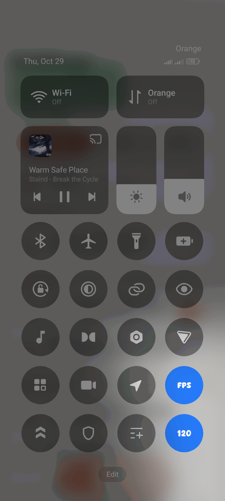

<div align="center">
  

  <h1><strong>akiHz</strong></h1>

  <h3>Android refresh-rate controls and FPS monitoring (FOSS)</h3>

  <p><strong>akiHz</strong> (pronounced "akiHertz") is an open-source Android app for switching display refresh rates and monitoring app FPS. It uses <a href="https://shizuku.rikka.app/">Shizuku</a>, with no root required.</p>

  <p>Choose your refresh rates, switch them from Quick Settings, and track FPS in a floating counter with an optional graph. Material 3 Expressive controls, app themes, and pill settings let you choose how it looks.</p>

<p>
  <a href="LICENSE"></a>
  <a href="app/build.gradle.kts"></a>
  <a href="https://github.com/anlaki-py/akihz/releases/latest"></a>
  <a href="https://github.com/anlaki-py/akihz/releases"></a>
  <a href="https://github.com/anlaki-py/akihz/commits"></a>
  <a href="https://ko-fi.com/unluky"></a>
  <a href="https://shizuku.rikka.app/"></a>
</p>

</div>

---

## Download

Download the latest APK from the [akiHz website](https://akihz.anlaki.dev/)
or [GitHub Releases](https://github.com/anlaki-py/akihz/releases/latest).
Most modern phones use the `arm64-v8a` APK; choose the `universal` APK if you
are unsure which architecture your device uses.

## Requirements

- [Shizuku](https://shizuku.rikka.app/) installed, running, and authorized
- A display that supports more than one refresh rate for rate switching
- No root access required

## Supported Android versions

akiHz supports **Android 11 and newer (API 30+)** and currently targets API 36.

## Screenshots

| Home | Settings |
|:---:|:---:|
|  |  |

| FPS overlay | Quick Settings tiles |
|:---:|:---:|
|  |  |

## Features

- Refresh-rate controls on Home, with a choice of which rates the Quick Settings tile cycles through.
- A draggable FPS counter with an optional graph, app or layer selection, and saved appearance settings.
- Material 3 Expressive styling, wallpaper colors, preset and custom themes, and optional custom fonts.
- Stable and beta update channels, scheduled checks, and in-app APK downloads.
- Background controls, manufacturer overrides, custom refresh-rate keys, and exportable diagnostic logs.

## FPS monitoring

The overlay shows app FPS reported by SurfaceFlinger. A 120 Hz screen can still
show a 30 FPS game. akiHz reads TimeStats through Shizuku about twice per second;
static screens can report 0 FPS.

Open **Settings → FPS Monitor → Surface FPS Monitor**, or use the **FPS Monitor**
Quick Settings tile. Grant Shizuku, overlay, and notification permissions when
asked. Drag the pill to move it; tap anywhere on it to open its menu.

The app's FPS page and the pill menu share these controls. Changes are saved and
stay in sync:

| Controls | Options |
|:---|:---|
| Counter | Size, FPS label, decimals, and compact spacing |
| Font | Follow the app font or use the system font for the pill only |
| Graph | Show or hide history, choose 10, 30, or 60 seconds, and adjust width and height |
| Surface | App theme or a fixed color, background opacity, shadow, outline, and corner radius |

The graph resets when the measured app or layer changes. Gaps in sampling are
left visible. You can select a target app from the FPS page or choose a measured
layer from the pill menu.

The method has been tested on Xiaomi 12T with Android 15 and HyperOS 2. Results
can vary by device. Full notes are in the Gist
[Real-Time FPS Monitoring with SurfaceFlinger TimeStats on Android 15 / HyperOS 2](https://gist.github.com/anlaki-py/d9c8cf06cd54149d522adb8e665bfbd0).

## Appearance

Choose System, Light, or Dark mode under **Settings → Appearance**. Open **Theme**
for the rest:

- Match your wallpaper with dynamic color, or choose and edit color schemes.
- Use pitch-black backgrounds in dark mode with the AMOLED option.
- Use the Material app icon or switch back to the original icon.
- Use Cute Dino titles and Soft Core descriptions, or restore the default fonts.

Quick Settings tile text follows the app font setting. The FPS overlay and its
menu follow the app theme; the pill also has its own font and color choices.

## Updates and release notes

Under **Settings → Updates**, choose Stable or Beta and check for updates manually
or on a daily, three-day, or weekly schedule. The app can download an APK and
verify its SHA-256 checksum before offering installation.

Hold the version row in Settings to read release notes or browse the bundled
changelog offline.

## Supported devices

I have only tested akiHz on my Xiaomi phone. The app includes support for
several other manufacturers and many other devices should work, but none are
tested or guaranteed.

If auto-detection fails, try **Settings → Refresh rate → OEM override** and select
your manufacturer manually.

## Install

Each release provides standalone APKs for `arm64-v8a`, `armeabi-v7a`, `x86`,
and `x86_64`, plus a `universal` APK. Most modern phones use `arm64-v8a`;
use `universal` if you are unsure.

Releases from `main` are stable. Releases from `beta` are marked as GitHub
prereleases. Both channels use the same application ID and signing key, and
monotonically increasing version codes, so a newer beta can update an installed
stable release without uninstalling it.

GitHub release assets use predictable names and include SHA-256 checksums and a
machine-readable `release-metadata.json` file for release indexers and Android
update clients. The metadata includes canonical project and release links,
release date, Shizuku requirement, APK download URLs, and the signing
certificate fingerprint shared by every APK variant.

See [CHANGELOG.md](CHANGELOG.md) for the complete release history.

## Usage

1. Open Shizuku and start it with wireless debugging or ADB.
2. Open akiHz and grant Shizuku permission. Grant notification and overlay permission when asked.
3. Select a refresh rate on Home. Use the tile buttons beside rates to choose which ones the **akiHz** Quick Settings tile cycles through.
4. Open **Settings → FPS Monitor → Surface FPS Monitor** to start monitoring and customize the counter, graph, and surface. The **FPS Monitor** tile also starts and stops monitoring.
5. Under **Settings → Background**, enable **Keep alive notification** if you want the refresh-rate controls kept ready. Use **Allow background running** to request a battery-optimization exemption.

## FAQ

**Why does Shizuku need to be running?**  
Android blocks normal apps from changing refresh-rate settings directly. Shizuku grants akiHz the privileged access needed to update the correct OEM-specific keys.

**Does the Quick Settings tile work when the app is closed?**  
Yes. With **Keep alive notification** enabled, akiHz uses a foreground service to keep its Quick Settings controls ready. Android displays a persistent notification while it runs. If your device still restricts it, use **Settings → Background → Allow background running** to request a battery-optimization exemption.

**My phone is not switching rates correctly? What should I try?**

1. Confirm Shizuku is running and akiHz has permission.
2. Try **Settings → Refresh rate → OEM override** and pick your manufacturer.
3. If it still does not work, fork the project and investigate support for your device.

**Is akiHz safe?**  
The app is MIT-licensed and open source. Refresh-rate controls write system settings through Shizuku. FPS monitoring reads SurfaceFlinger data and uses overlay permission to display the counter. Review the source to assess its behavior on your device.

## Contributions and support

This project does not provide support and is not accepting bug reports or
feature requests. You are welcome to fork it and make your own changes.

More projects by the developer are available at [anlaki.dev](https://anlaki.dev/).

## Error reports

Tap the version row six times to unlock Debug options, then open **Error logs**.
Use **Copy debug report** to copy recent errors and theme events, or **Share all logs**
to send every saved report in one text file.

Release builds save app warnings, errors, caught exceptions, and crashes. Android
process exit records are collected on the next launch, including available ANR
traces. An activity closing without a process crash may only leave lifecycle events.
Storage keeps the latest 100 errors, 30 crashes, 30 exits, and two small event logs.

## Build

Build the universal debug APK:

```bash
./gradlew :app:packageDebugUniversalApk
```

The APK is written to `app/build/outputs/apk_from_bundle/debug/app-debug-universal.apk`.

## License

[MIT](LICENSE)

## Project status and disclaimer

This is a personal app I vibe-coded to solve a problem I had. It is provided as
is, with no promise of quality, reliability, compatibility, maintenance,
support, or future updates. Development may slow down or stop permanently at
any time and without notice. Donations through
[Ko-fi](https://ko-fi.com/unluky) help keep maintenance going and make it less
likely the project gets abandoned. They do not buy support or guaranteed updates.

Please treat this repository as something to download and use at your own risk,
or fork and maintain yourself. Do not open issues asking for support, bug fixes,
device compatibility, features, or updates. If the app does not work for you,
you will need to diagnose and fix it yourself.

To the fullest extent permitted by law, I accept no responsibility or liability
for any damage, data loss, device problems, security issues, or other
consequences resulting from installing, using, modifying, or relying on this
app.
